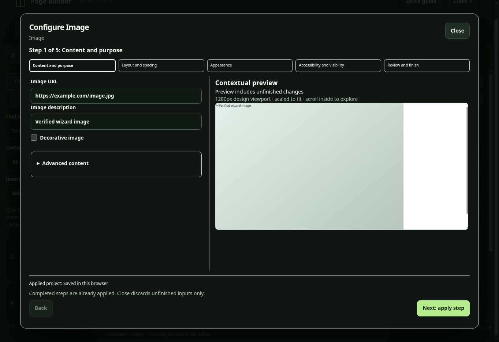

# Wizard release verification and autosave follow-up

## Published wizard

Verified the live route `/projects/page-builder` against production deploy
`6ad7d27013953e91b065eeb7`, published from commit
`459c951786c52129a0a32f2a43aee2cc71dc50cb` (PR #240).

A separate browser-local project was used. The live browser check confirmed:

- The wand arms element picking and selecting an image opens its wizard.
- Essential settings appear with Advanced content collapsed; the wide layout
  places the contextual preview beside the fields.
- An unsafe image URL is rejected, retained for correction, and focused.
- Completed content and layout steps update the canvas immediately.
- Undo reverses each completed step separately; single-step Redo restores it.
- The image description and 75% width persist after a saved project is reloaded.
- The preview iframe keeps its empty sandbox. Clicking it returns focus to the
  parent dialog; Escape then closes the wizard.

This was a desktop browser smoke check. Phone/4K browser viewport coverage is
provided by the automated tests. Physical TV remotes will not be verified and
are excluded from release acceptance under AC-EX-TV-REMOTE, approved by the
project owner on October 21, 2026. This is an accepted exception, not a passed
physical-device check. Real on-screen keyboards and assistive-technology checks
remain manual.

## Autosave pointer regression

The original CI trace from run `39470108321` showed the Pause effects button
remaining unpressed after its click, coinciding with autosave removing the
Retry save now toolbar row. This moves the editor while a pointer press is in
progress. A local repeat of the original WebKit workflow also lost a hover
state during autosave.

Two browser regressions were observed failing against the released code:

- Hold a real pointer press on Pause effects, advance the normal autosave timer,
  then release. The click must toggle Resume effects and pause the animation.
- Compare toolbar geometry before/after autosave at 320, 390, 768, 1440, 1920,
  and 3840 CSS pixels. The released code changed toolbar height by 56px at 320px.

The follow-up keeps Save now mounted, disables it when there are no editable
pending changes, and preserves Retry save now after failures. Invisible sizing
text reserves the space required by save and download label changes. This keeps
normal autosave from changing toolbar wrapping. Native button semantics and the
live save status remain in use.

The new timer-controlled tests exercise the real repository save path; they do
not replace storage or the application save handler. CI runs the held-pointer
regression across all three engines with retries disabled. Existing validation,
preview isolation, ownership checks and save-failure recovery are unchanged.
